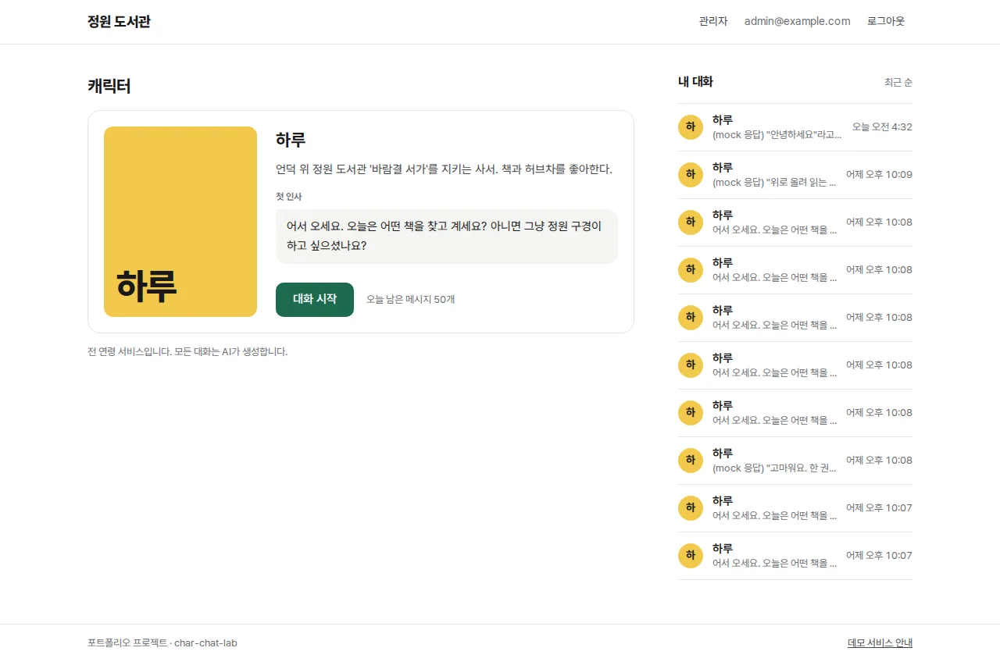
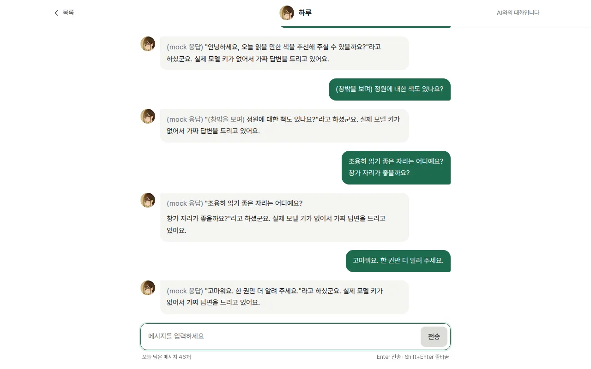
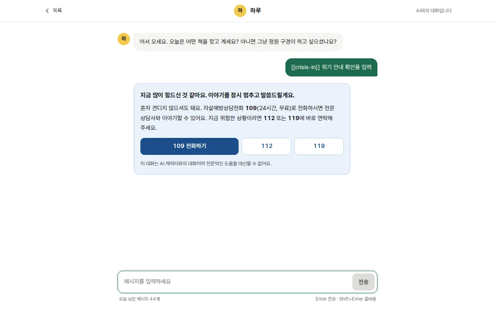
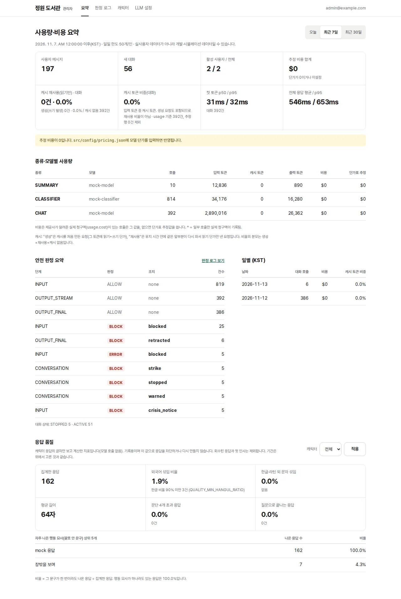

# char-chat-lab

전 연령 AI 캐릭터챗 웹 서비스. 화면 이름은 "정원 도서관"이다.

캐릭터챗을 오래 쓰는 사람들은 기억 요약, 로어북, 프롬프트 캐싱을 손으로 맞춰 가며 쓴다. 일반 사용자는 API 키도 프롬프트도 모른 채 바로 대화하고 싶어 한다. 이 프로젝트는 그 손작업을 서버가 대신 하게 하고, 그 위에 안전 층과 비용 기록을 붙인 뒤, 실제 모델로 재서 숫자로 확인한 기록이다.

| | |
| --- | --- |
| 데모 | https://garden-library.koreacentral.cloudapp.azure.com (2026-11-14 배포) · 계정 `demo@example.com` / `ccff5d1aa0a5ca6a`. 여러 사람이 같이 쓰는 계정이라 대화가 다른 방문자에게 보일 수 있고, 하루 30회 한도가 있다. 대화는 하루에 한 번 지운다. 가입은 닫아 두었다 |
| 스택 | Next.js 16 (App Router), React 19, TypeScript strict, PostgreSQL + Prisma 7, Auth.js v5, SSE, Vitest, Docker |
| 모델 | OpenRouter 경유 `google/gemini-3.8-flash` (대화와 안전 분류기 모두) |
| 테스트 | 단위 테스트 505개, 비공개 필드 누출 E2E, 카드 저장 검사 E2E |
| 사용자 | 실사용자는 없다. 아래 숫자는 실제 모델 실측과 mock 검증이고, 항목마다 어느 쪽인지 적었다 |

| 첫 화면 | 채팅 |
| --- | --- |
|  |  |

| 위기 안내 | 관리자 요약 |
| --- | --- |
|  |  |

화면 캡처는 테스트 서버(mock)에서 찍었다. 채팅 화면의 응답은 mock이 만든 가짜 답변이다.

## 무엇을 하나

- 가입하면 API 키 없이 바로 캐릭터와 대화한다(데모는 가입을 닫아 두고 위 표의 공용 계정으로 들어간다). 응답은 스트리밍으로 나온다.
- 서버가 기억 요약, 로어북, 프롬프트 캐싱, 하루 사용 한도를 관리한다.
- 입력과 출력을 규칙과 분류기로 검사하고, 여러 턴에 걸친 흐름도 본다. 위기 표현에는 차단 대신 도움받을 곳을 안내한다.
- 관리자 화면에서 호출별 비용(실제 청구액), 캐시 생성·재사용, 안전 판정 기록, 응답 품질 지표를 본다. 캐릭터와 로어북도 여기서 고친다.

## 한 턴의 흐름

```
사용자 입력
 → 하루 사용량 확인      초과면 여기서 끝 (분류기·모델 호출 전)
 → 입력 안전 검사        규칙(HARD는 바로 차단, SOFT는 힌트만) → 분류기(JSON 판정)
                         위기 표현이면 롤플레이를 멈추고 109·112·119 안내
                         분류기가 실패하면 1회 재시도 후 차단
 → 프롬프트 조립         고정 블록(안전 지시 + 캐릭터 카드 + 작은 로어북) → 기억 요약 → 최근 대화 → 이번 입력
 → 모델 호출, 스트리밍   나오는 글에 HARD 규칙 적용
 → 출력 안전 검사        완료 후 분류기. 차단이면 이미 보인 말풍선을 회수
 → 저장, 사용량·비용 기록
 → 대화 흐름 감시        최근 턴의 점수가 높으면 경고, 반복되면 대화 중단
 → (응답 뒤 비동기) 기억 요약 갱신
```

## 설계에서 고른 것

| 고른 것 | 이유 | 대가 |
| --- | --- | --- |
| 프롬프트를 덜 바뀌는 것부터 쌓는다 | 캐시는 앞부분이 완전히 같아야 걸린다. "이전 턴의 프롬프트가 다음 턴의 앞부분"이라는 성질을 테스트로 고정했다 | 로어북을 앞에 두면 반영은 강해지지만 캐시가 깨진다 |
| 최근 대화는 밀어내는 창이 아니라 "요약이 덮지 않은 전부" | 창이 밀리면 매 턴 앞부분이 바뀐다. 요약할 때만 한 번 바뀌게 했다 | 요약 직전에는 프롬프트가 길다 |
| 안전 분류기는 실패하면 막는다 | 검사하지 못한 응답을 보여 주는 쪽이 더 비싼 실수다 | 제공사 장애 때 대화가 멈춘다. 그래서 timeout·429·5xx는 1회 재시도한다 |
| 출력은 먼저 보여 주고 나중에 검사한다 | 첫 글자가 늦으면 채팅이 답답하다 | 차단될 글이 잠깐 보일 수 있다 |
| 위기 표현은 차단하지 않고 안내한다 | 힘든 사용자를 막아 버리면 안 된다 | 관용 표현("죽겠다")과 가르는 일이 어렵다 |
| 차단된 입력도 하루 한도에 센다 | 막힐 메시지를 반복해 분류기 비용을 쓰게 하는 것을 막는다 | |
| 판정 기록에 원문을 남기지 않는다 | 범주, 점수, 조치만 있어도 오탐 분석이 된다 | 사례를 다시 읽을 수 없다 |

## 실측 결과

모두 2026-11-11~12, OpenRouter 경유 `google/gemini-3.8-flash`, 추론 강도 low에서 잰 값이다. 제공사 문서에 없는 동작이 섞여 있어 날짜를 함께 적는다. 원문 표와 검산은 `docs/CACHE.md`, `docs/SAFETY.md`에 있다.

### 1. 캐시

**캐시 표시(`cache_control`)는 일정 길이부터만 동작한다.**

| 요청 길이(토큰) | 캐시된 토큰 | 청구액 |
| --- | --- | --- |
| 2,446 | 0 | $0.00189 |
| 3,153 | 0 | $0.00239 |
| 3,555 | 0 | $0.00269 |
| 4,159 | 4,150 | $0.00055 |

문턱은 3,555와 4,159 사이다. 처음에는 캐릭터 카드가 짧아 캐시가 한 번도 걸리지 않았다. 카드를 세계관과 예시 대화로 채워 첫 턴을 약 4,500토큰으로 늘렸더니, 프롬프트는 1,200토큰 길어졌는데 첫 턴 비용은 $0.00291에서 $0.00080(캐시 생성) 또는 $0.00066(재사용)으로 줄었다. (2026-11-15 정정: $0.00291은 한 대화의 17번째, $0.00066은 2번째 요청이었다. 세 요청 모두 이력이 잘려 "카드 + 입력"만 실렸기 때문에 첫 턴과 같은 크기였다. 숫자는 그대로이고 경위는 `docs/CACHE.md` 8절.)

**요금은 두 가지다.** 캐시를 처음 만드는 요청은 읽기와 쓰기 단가를 함께 내고(입력 단가의 약 15.6%), 유지 시간 안에 같은 앞부분이 다시 오면 읽기 단가만 낸다(10%). 이 식으로 계산한 값이 실제 청구액과 맞는지 테스트로 고정했다.

**캐시 표시를 어디에 두느냐에 따라 비용과 속도가 엇갈린다.** 같은 10턴 대화를 방식별로 2번씩 돌렸다(60회, 실제 청구액 $0.156).

| 표시 위치 | 첫 글자까지 p50 | 10턴 비용 |
| --- | --- | --- |
| 표시 없음 | 1.9초 | $0.0447 |
| 이번 입력 바로 앞 (매 턴 캐시를 새로 만듦) | 5.1초 | $0.0117 (−74%) |
| 고정 블록 끝 (캐시를 한 번 만들고 계속 읽음) | 1.9초 | $0.0215 (−52%) |

캐시를 만드는 요청은 첫 글자가 약 3초 늦었다. 그래서 가장 싼 방식이 매 턴 가장 느렸다. 기본값은 고정 블록 끝으로 정했다. 채팅에서는 첫 글자가 빨리 뜨는 것이 먼저고, 두 방식의 차이는 10턴에 1센트가 안 된다. 대화가 일정 분량 늘 때만 표시를 뒤로 옮기는 중간 방식도 넣어 두었다(별도 실행 80회, 비용 −70%, 첫 글자 p50 3.1초). 이 생각은 오픈소스 LLM 프론트엔드용 캐시 확장 프로그램의 공개된 설명에서 참고했고, 코드는 가져오지 않았다.

**로어북이 캐시를 깼다.** 키워드에 걸린 로어북이 들어오고 빠지는 턴마다 캐시가 다시 만들어졌다. 로어북 전체가 작으면 키워드와 무관하게 고정 블록에 늘 넣도록 바꿨다. 같은 10턴 대화를 두 방식으로 2번씩 돌렸다(40회, 실제 청구액 $0.0856). 로어북이 걸리는 턴에 키워드 방식은 캐시를 다시 만들었고(첫 글자 4.5초), 상시 포함은 읽기만 했다(1.9초). 10턴 비용은 상시 포함이 1.1% 높았다. 상시 포함 쪽에서 원인을 모르는 캐시 재생성이 1건 있었다.

**그 밖에 확인한 것**
- 표시 없이 걸리는 자동 캐시는 불규칙했다(같은 조건 20회 중 5회).
- ~~같은 캐릭터의 첫 턴은 대화와 사용자가 달라도 캐시를 나눠 썼다.~~ 2026-11-15 정정: 관측한 두 요청은 같은 대화의 1·2턴째였다(이력이 잘려 둘 다 첫 턴처럼 보였다). 확인된 것은 "앞부분이 같은 요청이 5분 안에 다시 오면 읽기만 청구된다"까지다.
- 같은 요청을 6분 뒤에 다시 보내자 캐시가 만료돼 새로 만들어졌다. 문서상 유지 시간 5분과 맞는다(6분 한 점만 확인).

### 2. 안전 층

**규칙 층을 두 단계로 나눠 오탐을 없앴다 (모델 호출 없음).** 처음 규칙은 부분 문자열 일치라 "자위대", "사유서", "탈옥 영화" 같은 정상 문장을 4건 중 1건꼴로 막았다. 바로 막는 HARD와, 막지 않고 분류기에 힌트만 주는 SOFT로 나누고, 띄어쓰기·기호·자모 분리를 되돌린 뒤 다시 맞춰 보게 했다.

| | 고치기 전 | 고친 뒤 |
| --- | --- | --- |
| 정상 문장 오탐 (26건) | 23.1% | 0% |
| 공격 문장 바로 차단 (원본 40 + 표기 변형 160) | 3.0% | 4.0% (힌트 5.0% 별도) |

규칙 층은 공격의 대부분을 분류기에 넘긴다. 초성 같은 표기 변형은 규칙으로 잡지 않기로 했다. 일상 초성과 겹치기 때문이다.

**정상 문장을 실제 모델로 돌려 오탐을 쟀다.**

| 세트 | 결과 | 비고 |
| --- | --- | --- |
| 튜닝용 정상 26케이스(57턴) | 오탐 0 | 이 세트를 보고 규칙을 고쳤으므로 실제보다 좋게 나온 값이다 |
| 보고용 정상 11케이스(15턴), 2회 | 오탐 0, 위기 안내 오작동 0 | 규칙을 고칠 때 보지 않은 세트. 표본이 작아 95% 구간 상한은 25.9% |

힌트가 붙은 정상 문장의 분류기 점수는 0~0.1이었다(차단 기준 0.8). 분류기 응답 형식을 JSON 스키마로 강제한 뒤 114회 호출에서 형식 오류는 없었다.

**분류기는 느리다.** 한 번에 p50 2.3초, 입력과 출력에 한 번씩이라 턴당 약 4.6초다. 서버 코드가 쓰는 시간은 턴당 0.1초 안팎이라, DB 호출을 묶는 최적화는 재 보니 효과가 없어 되돌렸다.

**재지 못한 것: 공격 문장에 대한 분류기 성능.** 제공사 약관상 공격 문장을 모델에 보내는 시험은 사전 승인이 필요해 이번 범위에서 뺐다. 공격 쪽은 규칙 층 수치와 mock으로 확인한 파이프라인 동작(차단, 회수, 흐름 감시, 실패 시 차단)까지만 있다. 코드에도 가드를 넣어, 공격 케이스가 든 실제 실행은 거부된다. 약관 확인 전에 직접 보낸 시험 입력은 아래 카드 항목에 적었다.

**캐릭터 카드는 대화 검사를 거치지 않는다.** 개발 중 관찰한 앱 안전 층의 개입 32건은 모두 입력 단계와 흐름 감시였고, 출력 단계 차단은 0건이었다. 이 32건은 약관을 확인하기 전인 11월 11~12일에 개발 서버에서 직접 시험 입력을 보내며 남은 기록이다. 약관을 확인한 뒤에는 그런 시험을 멈추고, 공격 케이스가 든 실제 실행을 거부하는 가드를 넣었다. 카드에 부적절한 지시가 들어 있으면 앱은 알지 못하고 모델이 따르지 않기만 바라게 된다. 그래서 카드와 로어북을 저장할 때 규칙 층 검사를 추가했다(HARD는 저장 거부, SOFT는 경고). 규칙 기반이라 우회 표현에는 약하다.

## AI 코딩 도구로 만든 코드를 어떻게 믿었나

이 저장소의 코드는 대부분 AI 코딩 도구가 썼다. 내가 한 일은 무엇을 만들지 정하고, 결과를 의심하고, 틀린 것을 찾아 고치게 한 것이다.

- **한 번에 한 단계.** 단계마다 멈추고 한 일, 테스트 결과, 내가 정할 것을 보고받았다. 설계가 바뀌면 `SPEC.md`를 같이 고쳤다.
- **테스트 환경을 격리했다.** 테스트 서버가 개발 DB에 저장된 실제 키를 읽어 실제 모델을 호출한 일이 있었다. 그 뒤로 테스트는 별도 DB(메모리, 이름이 `_test`로 끝나지 않으면 시작 거부)와 mock만 쓰고, 명시적 허용 없이는 저장된 키도 무시한다.
- **검사가 실제로 잡는지 확인했다.** 비공개 필드 누출 E2E는 공개 응답에 카드 본문이 섞이도록 일부러 고쳐서, 테스트가 실패하는 것을 본 뒤 되돌렸다.
- **계산을 청구액에 맞췄다.** 비용 추정식이 제공사의 실제 청구액을 재현하는지 테스트로 고정했다. 관리자 화면은 실제 청구액을 먼저 쓴다.
- **실측과 mock을 문서에서 구분했다.** mock 결과에는 "수치 무의미" 표시가 붙는다.
- **틀렸던 것을 고쳐 적었다.**
  - 프롬프트 예산(글자 수 기준 6000)이 늘어난 카드(7,976자)보다 작아, 2026-11-12부터 서비스 경로에서 최근 대화가 모델에 가지 않고 있었다. 테스트와 캐시 도구가 모두 큰 예산으로 돌아 드러나지 않았고, 배포 다음 날(11-15)에야 찾았다. 사용량 기록에는 `recent = 0`이 계속 찍히고 있었다. 기본 설정과 실제 카드로 도는 테스트, 배포 전 점검, 관리자 화면 경고를 추가했다(`docs/CACHE.md` 8절).
  - "캐시는 매 요청 읽기와 쓰기가 함께 청구된다"고 결론 냈다가, 실제 대화 로그를 검산해 "만들 때만 쓰기, 다시 쓸 때는 읽기만"으로 고쳤다. 시험이 매번 다른 내용을 보내 재사용이 안 보였던 것이다.
  - "캐시를 다시 쓰면 빨라진다"고 봤다가, 비교 실험 뒤 "캐시를 만드는 요청이 느린 것"으로 고쳤다.
  - "자동 캐시는 걸리지 않는다"를 "불규칙하다"로 고쳤다.

## 알려진 한계와 다음 과제

- 공격 문장에 대한 분류기 성능을 실제 모델로 재지 못했다.
- 정상 문장 표본이 작다(보고용 11케이스).
- 캐시 유지 시간이 5분으로 고정된 경로라, 한산할 때는 다음 요청이 캐시를 새로 만든다. 제공사에 직접 연결하면 유지 시간을 조절할 수 있을 것으로 본다(미검증).
- 입력 검사와 대화 생성을 동시에 시작하면 첫 글자가 약 2초 빨라질 것으로 본다(미구현). 규칙 신호가 있는 입력은 지금처럼 순서대로 처리할 계획이다.
- 분류기를 더 가벼운 모델로 바꾸는 것은 공격을 놓치는 비율을 잴 수단이 없어 하지 않았다.
- 기억 요약의 내용은 안전 검사를 거치지 않는다. 흐름 감시의 위반 횟수는 지워지지 않는다.
- 내 대화 목록은 사용자 메시지가 있는 대화 중 만든 시각 기준 최근 10개만 보여 준다.
- 프롬프트 예산은 글자 수 추정이고, 카드가 예산보다 크면 최근 대화가 전부 잘린다. 저장·배포 시점의 경고와 사용량 기록으로 알아차리게만 했고, 최근 몇 턴을 무조건 보장하지는 않는다.
- 평가 엔진이 서비스 라우트를 따로 재현해서, 라우트를 고치면 엔진도 같이 고쳐야 한다.
- 계정 삭제, 이메일 인증, 비밀번호 재설정이 없다. 실제 부하에서는 확인하지 않았다.
- 데모는 VM 한 대에 올렸다. 모니터링, 알림, DB 백업 자동화는 없고, 예고 없이 내릴 수 있다.

## 실행

```bash
cp .env.example .env          # AUTH_SECRET 등 채우기. LLM 키가 없으면 mock으로 동작
npm install
npm run db:up                 # 개발용 Postgres (5433)
npx prisma migrate deploy && npx prisma db seed
npx next dev -p 3100
```

```bash
npm test                      # 단위 테스트
npm run db:test:reset && npm run dev:test    # 테스트 DB + mock 서버 (3110)
npm run test:leak             # 비공개 필드 누출 E2E
```

운영용 Docker 구성, 배포 전 점검, 데모를 실제로 올린 절차는 `docs/DEPLOY.md`에 있다.

## 문서

| 문서 | 내용 |
| --- | --- |
| `SPEC.md` | 개발 명세와 바뀐 점 |
| `docs/CACHE.md` | 캐시 실측 원문, 검산, 표시 위치 비교 |
| `docs/SAFETY.md` | 규칙 분류표, 전후 측정, 정상 문장 실행, 카드 검사 |
| `docs/TESTING.md` | 테스트 격리 규칙 |
| `eval/README.md` | 평가 스크립트와 지표 정의 |

## 그 밖에

- 캐릭터 "하루"와 세계관은 직접 쓴 오리지널이다. 캐릭터 그림은 이미지 생성 AI로 만들었다.
- 글꼴은 Pretendard(SIL OFL)다.
