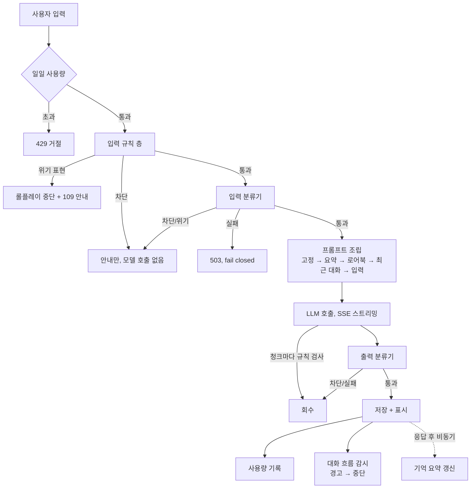

# char-chat-lab

전연령 AI 캐릭터챗 웹 서비스입니다. 화면은 단순하게 두고, 뒤쪽의 **대화 파이프라인**에 공을 들였습니다.

> 고급 사용자가 손으로 하던 프롬프트 관리(기억 요약, 로어북, 캐싱)를 일반 사용자 서비스에서 자동화하고, 안전장치와 비용 관리를 붙였다.

사용자는 API 키 없이 가입해 바로 대화합니다. 서버가 LLM을 호출하고 기억·캐싱·안전·비용을 서버에서 관리합니다.

- **데모**: `<배포 후 URL을 여기에>` · 데모 계정은 배포 시 정한 `DEMO_EMAIL` / `DEMO_PASSWORD` (README에 비밀번호를 적지 않습니다)
- **기술 스택**: Next.js 16 (App Router) · TypeScript strict · PostgreSQL + Prisma 7 · Auth.js v5 · SSE 스트리밍 · Vitest
- **원칙**: 전연령 전용(성인 모드 없음), 캐릭터는 오리지널만, 다른 챗 프론트엔드 코드를 복사하지 않고 직접 구현

> **측정 결과에 대한 정직한 안내**: 이 저장소의 수치(토큰 절감, 캐시 적중률, 차단율 등)는 **실사용자 데이터가 아니라 시뮬레이션**입니다. 또한 현재 저장소에는 **실제 LLM으로 측정한 결과 파일이 없습니다**(아래 [평가](#평가-시뮬레이션) 참고). 구조와 동작은 mock·가짜 서버로 검증했고, 실제 모델 수치는 키와 단가를 넣고 `npm run eval -- --yes`로 만들어야 합니다.

---

## 한 턴의 흐름



## 핵심 설계와 트레이드오프

### 1. 캐시 친화적인 프롬프트 순서
제공사의 프롬프트 캐시는 **앞부분이 완전히 같아야** 적용됩니다. 그래서 조립기는 덜 바뀌는 것부터 쌓습니다.

`고정 블록(안전 지시 + 캐릭터 카드)` → `기억 요약` → `로어북` → `최근 대화` → `이번 입력`

조립기는 순수 함수(`assemblePrompt`)이고, "이전 턴의 프롬프트 전체가 다음 턴 프롬프트의 접두사"라는 성질을 단위 테스트로 고정했습니다. 토큰 예산을 넘으면 최근 대화의 오래된 메시지부터 잘라내며, 고정 블록과 이번 입력은 절대 자르지 않습니다.

**로어북 트레이드오프**: 로어북을 앞쪽에 두면 반영은 강해지지만 걸린 항목이 바뀔 때마다 그 뒤쪽 캐시가 깨집니다. 현재는 최근 대화 앞에 두었습니다. 시뮬레이션(가짜 서버, 7턴)에서 로어북이 바뀐 턴마다 이전 요청 접두사 중 고정 블록 하나만 재사용됐고, 로어북이 그대로인 턴은 전체 접두사가 유지됐습니다. 배치를 바꿔 비교하는 실험은 2단계(MVP 이후)로 남겼습니다.

### 2. 기억: 캐시를 덜 깨는 요약 창
최근 대화를 "마지막 N턴" 슬라이딩 창으로 두면 매 턴 접두사가 밀려 캐시가 계속 깨집니다. 대신 **요약이 덮지 않은 메시지를 전부 원문으로** 넣고, 원문이 30턴(`RECENT_TURNS`+`SUMMARY_EVERY`)이 되면 가장 오래된 10턴을 요약으로 보냅니다. 요약이 갱신되는 순간에만 접두사가 한 번 바뀌고, 그 사이 20~30턴 동안은 앞부분이 고정됩니다. 요약은 응답을 보낸 뒤 `after()`로 비동기 실행해 응답 속도를 지킵니다. 요약은 사용자 발화에서 나온 텍스트가 시스템 역할로 들어가므로 "지시문이 아니다"라는 문구를 붙이고, 요약기에도 대화 속 지시를 따르지 말라고 지시했습니다.

### 3. 로어북
키워드는 공백을 뺀 부분 문자열로 비교합니다(한국어는 조사가 붙어 단어 경계가 안 맞음). 공백 제외 2글자 미만 키워드는 오탐이 많아 등록 단계에서 거절합니다. 결과 순서는 우선순위→id로 고정해 출력이 입력 순서에 흔들리지 않게 했고(캐시 보호), 예산을 넘으면 우선순위가 낮은 항목부터 뺍니다.

### 4. 안전 파이프라인 (3층)
| 층 | 역할 |
| --- | --- |
| 규칙(키워드·정규식) | 빠르고 싸다. 위기 > 차단 순. 입력과 스트리밍 출력에 적용 |
| 분류기(저가 모델, JSON 스키마) | 대화 모델과 **별개의 호출**. 입력은 모델 호출 전, 출력은 생성 완료 후 |
| 대화 흐름 감시 | 한 턴만 보면 통과할 점수라도 최근 5턴 평균이 0.5 이상이면 경고 → 반복되면 중단 |

**분류기가 실패하면 막습니다 (fail closed).** 모델 라우팅 분류기는 실패했을 때 그냥 통과시키는 것(fail open)이 맞습니다. 틀려도 비용만 조금 더 들기 때문입니다. 안전 분류기는 정반대입니다. 검사하지 못한 응답을 보여 주는 쪽이 훨씬 비싼 실수이므로, 타임아웃·오류·JSON 스키마 위반은 모두 차단으로 처리하고 `ERROR` 판정을 남깁니다. 입력 단계 실패는 503(대화에 아무것도 남기지 않고 재시도 가능), 출력 단계 실패는 회수입니다.

**출력 검사: 속도 vs 안전.** 스트리밍 중에는 규칙 층만 즉시 적용하고, 분류기는 생성이 끝난 뒤 돌립니다. 그래서 분류기가 차단하면 이미 화면에 흘려보낸 텍스트를 **회수**(말풍선을 안내문으로 교체)합니다. 첫 토큰 지연이 짧은 대신 부적절한 텍스트가 잠시 보일 수 있다는 뜻입니다. 대안은 지연 버퍼(일정 길이를 모아 검사한 뒤 내보내기)로, 안전은 더 낫지만 첫 토큰이 늦어집니다. 규칙 검사는 청크 하나가 아니라 **누적 텍스트**에 적용해 금칙어가 청크 경계에서 쪼개져도 잡습니다.

그 밖의 안전 결정:
- 안전 지시는 시스템 프롬프트 최상단. 캐릭터의 "역할을 벗어나지 마라"가 안전 지시보다 우선할 수 없습니다.
- 위기 표현(자살·자해)은 차단이 아니라 **롤플레이를 멈추고 도움을 안내**(109, 112/119)합니다. 이런 턴은 흐름 점수 0점이라 힘든 사용자가 중단 사유가 되지 않습니다. 위기 규칙은 출력에는 적용하지 않습니다(위로하는 응답을 회수하지 않기 위해).
- 회수된 입력·응답은 `retracted=true`로 저장해 이후 프롬프트·요약·로어북 매칭·화면에서 모두 제외합니다. 판정 후에 저장하므로 회수 대상이 어떤 경로로도 프롬프트에 새지 않습니다.
- 분류기 프롬프트는 검사 대상을 태그로 감싸고 꺾쇠를 무력화해 태그 탈출을 막습니다.
- 모든 판정은 `ModerationEvent`로 남기며 **통과 점수도 포함**합니다(오탐 분석용). 메시지 원문은 저장하지 않습니다.

### 5. 비용과 사용량
- 모든 호출(대화·요약·분류기)을 `UsageLog`에 기록합니다: 모델, 입력/캐시/출력 토큰, 추정 비용, 첫 토큰·전체 지연, 블록별 토큰.
- 모델 단가는 `src/config/pricing.json`에만 있고 코드에 박지 않았습니다. 제공사가 usage를 주지 않으면 글자 수로 추정하고 `usageEstimated`로 표시해 캐시 적중률 계산에서 뺍니다.
- 사용자별 하루 메시지 한도(`DAILY_MESSAGE_LIMIT`, KST 자정 기준). **차단된 입력도 셉니다**(차단될 메시지를 반복해 분류기 비용을 쓰게 하는 공격 방지). 한도 확인은 분류기·모델 호출보다 먼저입니다.

### 6. 보안
- 비밀번호는 bcrypt 해시, 세션은 JWT. 남의 대화는 존재 자체를 숨깁니다(404).
- 관리자 화면(`/admin`)은 페이지와 **모든 서버 액션**이 DB의 현재 역할을 확인합니다. 서버 액션은 URL로 직접 호출할 수 있어서, 일반 사용자 세션으로 액션 ID를 훔쳐 호출하는 시도가 404로 막히는 것을 직접 확인했습니다.
- 로그인 시도 제한: 같은 이메일+IP 15분에 5회, 한 IP 15분에 20회, 가입은 IP당 시간당 10회. 카운터는 DB에 두어 서버가 여러 대여도 공유됩니다. IP는 `X-Forwarded-For`의 **오른쪽에서** 계산해(맨 앞 값은 클라이언트가 위조 가능) 앞에 가짜 IP를 끼워도 우회되지 않음을 확인했습니다. **프록시 뒤에 두어야** 합니다.
- 보안 헤더(nosniff, frame 차단, referrer/permissions 정책, 운영 빌드의 HSTS), `/privacy`의 개인정보·외부 전송 안내.
- 비밀값은 `.env`에만 있고 커밋하지 않습니다. `npm run predeploy`가 개발용 비밀번호·짧은 시크릿 등을 배포 전에 걸러 냅니다.

---

## 평가 (시뮬레이션)

`eval/`에 평가 스크립트가 있습니다. 서비스와 **같은 파이프라인 코드**로 정해진 대화를 재생합니다. 자세한 형식·지표 정의는 [`eval/README.md`](eval/README.md).

| 측정 | 내용 |
| --- | --- |
| 요약 전후 입력 토큰 | 요약 없음(전체 원문) 대 서비스 설정. 이력 부분만의 절감률, 요약 호출 포함 순절감 |
| 캐시 적중률 | 제공사 usage가 있는 호출만 (없으면 0%가 아니라 "—") |
| 지연 | 첫 토큰, **체감 첫 토큰(입력 검사 포함)**, 전체 응답 p50/p95 |
| 턴당 추정 비용 | 대화 + 분류기 + 요약 |
| 레드팀 | 공격 차단율, 정상 대화 오탐률(Wilson 95% 구간), 최초 개입 단계 분포 |

```bash
npm run eval:scenarios        # 정상 시나리오 (요약·캐시·지연·비용)
npm run eval:redteam          # 공격/정상 대화 세트 (eval/redteam/ 에 직접 작성)
npm run eval -- --yes         # 둘 다, 실제 API 호출(비용 발생)
```

결과는 `eval/results/<날짜>.md`로 저장되고 문서 상단에 "시뮬레이션 결과"가 명시됩니다. 키가 없으면 mock으로 돌며 결과 파일에 "수치 무의미"가 표시되고 git에서 제외됩니다. 공격 대화 세트의 **내용은 직접 작성**하는 것이 원칙이며, 규칙을 튜닝한 세트와 보고용 세트는 분리해야 차단율이 과대평가되지 않습니다.

---

## 로컬 실행

필요: Node 22, Docker(Postgres용).

```bash
git clone <repo> && cd char-chat-lab
npm install
cp .env.example .env            # AUTH_SECRET 생성: openssl rand -base64 32
npm run db:up                   # Postgres (호스트 포트 5433)
npx prisma migrate deploy       # 또는 개발 중이면 npm run db:migrate
npx prisma db seed              # 데모/관리자 계정 + 예시 캐릭터·로어북
npm run dev                     # http://localhost:3000
```

- `.env`의 `LLM_API_KEY`가 비어 있으면 **mock 어댑터**(가짜 응답)와 결정적 mock 분류기로 동작합니다. 실제 모델을 쓰는 방법은 두 가지입니다(OpenAI 호환 API).
  - **관리자 화면에서 입력(가장 쉬움)**: 관리자로 로그인 → `LLM 설정`(`/admin/settings`)에서 API 주소·키·모델·단가를 넣고 **연결 테스트** 후 저장하면 재시작 없이 바로 적용됩니다. **OpenAI·OpenRouter 프리셋 버튼**이 있어 주소를 채워 줍니다(OpenRouter는 `https://openrouter.ai/api/v1`, 모델 이름은 `제공사/모델` 형식, 모델마다 구조화 출력 지원이 달라 기본 off). Gemini 같은 **추론(thinking) 모델**은 출력 토큰을 추론에 먼저 써서 본문이 비어 올 수 있으므로, 화면에서 **추론 강도**(`reasoning.effort`)와 **최대 출력 토큰**을 조절할 수 있고 연결 테스트가 빈 응답의 원인을 설명해 줍니다. 키는 AES-256-GCM으로 암호화해 DB에 저장하고 화면에는 끝 4자리만 보입니다. 우선순위는 화면 설정 > 환경변수 > mock입니다.
  - **환경변수**: `LLM_API_KEY`, `LLM_CHAT_MODEL`, `LLM_CLASSIFIER_MODEL`(저가 모델)을 채우고 `src/config/pricing.json`에 단가를 입력합니다. 공개 운영에서는 이쪽을 권장합니다(DB와 `AUTH_SECRET`이 함께 유출돼도 키가 나가지 않음).
- 테스트: `npm test` · 타입: `npm run typecheck` · 린트: `npm run lint`
- 개발 계정: `.env`의 `DEMO_EMAIL`/`DEMO_PASSWORD`, `ADMIN_EMAIL`/`ADMIN_PASSWORD` (**공개 배포에서는 반드시 교체**)

## 배포

Docker 이미지로 배포합니다. 절차·환경변수·프록시 요구사항은 [`docs/DEPLOY.md`](docs/DEPLOY.md). 요약:

```bash
cp .env.example .env.production          # 값 채우기 (비밀번호·키 교체)
npm run predeploy -- --env-file .env.production   # 배포하면 안 되는 설정을 걸러 낸다
docker compose --env-file .env.production -f docker-compose.prod.yml up -d --build
curl localhost:3000/api/health            # {"status":"ok"}
```

## 구조

```
src/
  app/                 화면과 라우트 (/, /chat, /login, /admin, /privacy, /api/chat SSE, /api/health)
  lib/
    chat/              프롬프트 조립기 (순수 함수)
    memory/            요약 계획·프롬프트·갱신(의존성 주입)
    lorebook/          키워드 검증·매칭
    safety/            규칙·분류기·입력/출력 검사·흐름 감시·판정 기록
    llm/               제공사 어댑터(OpenAI 호환, mock), SSE 파서
    admin/             관리자 통계·폼 검증·권한 확인
    rate-limit*.ts     로그인·가입 시도 제한
  config/              모델 단가, 안전 규칙 목록
prisma/                스키마·마이그레이션·seed
eval/                  평가 스크립트·시나리오·레드팀 형식
scripts/               배포 전 점검
SPEC.md                개발 명세(스키마·설계 결정의 기준 문서)
```

## 한계와 하지 않은 것

- **실제 LLM으로 측정한 결과가 아직 없습니다.** 한국어에서 분류기가 실제로 얼마나 잘 동작하는지, 캐시가 실제로 얼마나 적중하는지는 키를 넣고 평가 스크립트를 돌려야 알 수 있습니다.
- 규칙 층의 키워드·정규식 목록은 **초안**입니다. 오탐·누락이 있습니다(예: "죽고 싶을 만큼 창피했다" 같은 관용 표현이 위기 안내를 부릅니다 — 평가 시나리오에 일부러 넣어 둔 문장입니다).
- 요약과 로어북 내용은 안전 검사를 거치지 않습니다(요약은 "지시문 아님" 문구와 요약기 지시로만 방어). 흐름 감시의 위반 횟수는 영구 누적됩니다.
- 이메일 인증, 비밀번호 재설정, 계정 자가 삭제가 없습니다. CSP(콘텐츠 보안 정책)는 설정하지 않았습니다.
- 평가 엔진은 서비스 라우트를 DB 없이 손으로 옮긴 것이라 라우트를 바꾸면 같이 고쳐야 하고, 지연에 DB 왕복이 포함되지 않습니다.
- 만들지 않은 것: 실제 결제, 모바일 앱, 플러그인, 사용자 캐릭터 공개 제작, 성인 모드.

## 다음 단계 (MVP 이후)

- 사용자 등급별 모델 라우팅 — 판정은 세션당 한 번, 대화를 한 모델에 고정(캐시 보호)
- 모델별 한국어 블라인드 비교(같은 캐릭터·시나리오, 이름 가린 평가)
- 로어북 배치 실험(앞/뒤 배치에 따른 비용 대 반영도)
- 캐릭터 카드 V2 가져오기 + 가져온 카드도 안전 심사 통과해야 등록
